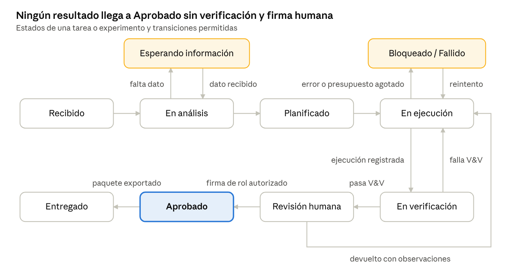
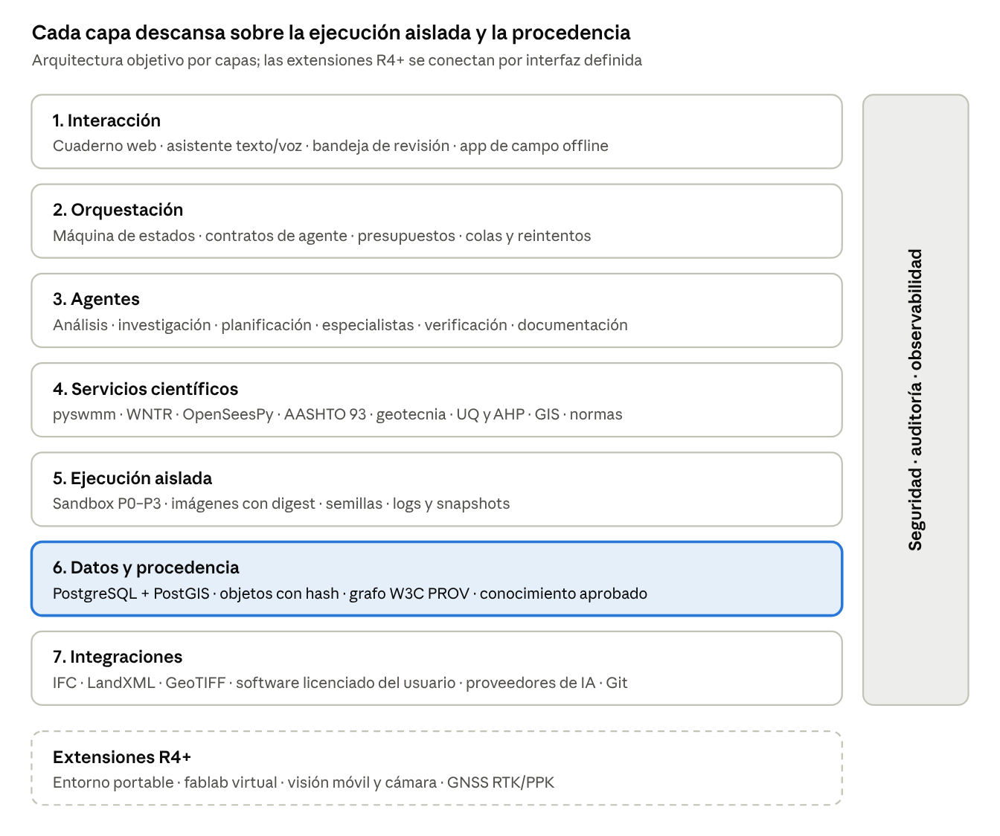

# MATTX — Brief Maestro v1.4

Plataforma de IA para el desarrollo científico de la ingeniería civil · Oct 14, 2026 · @Chris

## 0. Control del documento

Esta versión reescribe el **capítulo 3 (alcance y releases)**: el ámbito científico es abierto y cada release cierra solo la prueba de su capacidad; se agregan las áreas complementarias, la continuidad obligatoria entre releases y el ciclo de feedback y mejora. El capítulo fue aceptado por el autor el 14-oct-2026 con esas dos condiciones, que se incorporan como §3.5 y §3.6. Mantiene la corrección normativa de la v1.3 (CE.040) y el marco bibliográfico universal de la v1.2.

Este documento se rige por la [Constitución de MATTX](../../../CONSTITUCION.md); en caso de conflicto prevalece la Constitución.

| Campo | Definición |
|---|---|
| Producto | MATTX |
| Tipo | Plataforma de investigación y desarrollo científico en ingeniería civil, asistida por IA multiagente |
| Versión | 1.4 (reemplaza a 1.3 del 13-oct-2026) |
| Vigencia | Toda versión anterior queda superada por esta y se conserva solo como historial. Las referencias de otros documentos a versiones anteriores de este brief se entienden hechas a esta |
| Documentos relacionados | [Brief de Agentes v1.1](../../Brief_Agentes/v1.1/MATTX_Brief_Agentes_v1.1.md) · [Brief de Implementación v2.1](../../Brief_Implementacion/v2.1/MATTX_Brief_Implementacion_v2.1.md) |
| Estado | Especificación objetivo. Ningún componente se considera implementado por estar descrito |
| Autor | Chris (Ingeniero civil-sanitario) |
| Aprobadores | Pendiente: responsable técnico, responsable científico, responsable de producto |
| Jurisdicción de cumplimiento inicial | Perú (RNE, MTC, Invierte.pe), configurable por proyecto |
| Marco bibliográfico | Universal: normas, guías, literatura y datos nacionales e internacionales (sección 3.3) |
| Primer entregable construible | R1: flujo científico de drenaje pluvial urbano (sección 14) |

**Convención normativa.** En este documento **DEBE** indica obligación verificable; **DEBERÍA** indica recomendación fuerte que solo se omite con justificación escrita en un ADR; **PUEDE** indica opción. Toda obligación DEBE tener al menos una prueba vinculada.

**Cambios respecto a v1.3**

| Área | v1.3 | v1.4 |
|---|---|---|
| Alcance | Cada release con alcance cerrado | Ámbito científico **abierto**; cada release cierra solo la prueba de su capacidad (§3.0) |
| Releases | Tabla de 3 columnas | Capacidad, ámbito, casos de referencia, áreas complementarias y criterio de salida (§3.1) |
| R0 | Sandbox sin red | Perfiles **sin red** y de **red controlada** con lista permitida (§3.1.1) |
| R1 | Flujo de drenaje | Ciclo científico completo para cualquier dominio; drenaje como demostrador + **prueba de generalidad** |
| R2 | Cinco dominios | Procedimiento para incorporar cualquier dominio y **flujos acoplados** entre disciplinas |
| R3 | Integraciones y conectores licenciados | **Motores propios** (primero drenaje) y software de terceros "no confiable hasta verificar" (§3.1.2) |
| R4+ | Lista cerrada de extensiones | **Registro abierto** de extensiones |
| Áreas complementarias | — | 15 áreas con aporte, ejemplo y release de entrada (§3.4) |
| Continuidad | — | Criterio de entrada y **paquete de traspaso** obligatorios por release (§3.5) |
| Feedback | — | Registro, clasificación, informe de cierre, punto de decisión y versiones **Rn.x** (§3.6) |
| Entregables (§15.3) | — | Paquete de traspaso y registro de feedback en cada release |

**Cambios de v1.2 a v1.3 (historial)**

| Área | v1.2 | v1.3 |
|---|---|---|
| Norma de drenaje | RNE OS.060 Drenaje pluvial urbano | **RNE CE.040 Drenaje Pluvial**: la OS.060 fue renombrada y trasladada (DS 012-2020-VIVIENDA) y su contenido modificado (RM 126-2021-VIVIENDA). R1 se basa en la CE.040 |
| Contrataciones | Ley de Contrataciones del Estado | **Ley N.° 32069**, Ley General de Contrataciones Públicas (vigente desde abril de 2025; deroga la Ley 30225) y su reglamento (DS 009-2025-EF) |
| E.030 | Sin modificación indicada | Modificada por la RM 183-2026-VIVIENDA, con régimen transitorio |
| Matriz internacional | Incluía ASME V&V 40, "NTC/CONAGUA MAPAS" y "ASPRS Positional Accuracy Standards for Digital Geospatial Data" | Se retira ASME V&V 40 (dispositivos médicos); se corrigen a "CONAGUA MAPAS" y "ASPRS Positional Accuracy Standards for Digital Geospatial Data". El resto queda **por verificar** ([revisión](../../Revisiones/2026-10-13_verificacion_matriz_normativa.md)) |
| Catálogo de agentes (§7.2) | 11 filas con nombres propios | 21 agentes base con los nombres unificados del Brief de Agentes v1.1 |
| Roles de diseño | "Roles del equipo de construcción, no agentes" | **Son agentes** (grupo B); las personas aprueban en G-UI |
| Flujo R1 (§14.2) | Agentes genéricos | Cada paso nombra a su agente; sensibilidad a cargo de Incertidumbre y experimentación |
| Máquina de estados | "Informe V&V aprobado" emitido por un agente | "Informe V&V sin defectos bloqueantes": los agentes no aprueban |

**Cambios de v1.1 a v1.2 (historial)**

| Área | v1.1 | v1.2 |
|---|---|---|
| Jurisdicción | Perú como jurisdicción inicial y matriz normativa nacional (más ASME/ISO para V&V) | Dos capas separadas: jurisdicción de cumplimiento (por proyecto) y marco bibliográfico universal |
| Matriz de referencia | Normas peruanas por dominio | Normas nacionales + internacionales + referentes comparados + literatura científica indexada por dominio (3.3) |
| Principios | 10 principios | + Principio "Conocimiento sin fronteras" |
| Agente de investigación | Busca normas, literatura y datos | Búsqueda obligatoria en fuentes nacionales e internacionales; registra DOI, país u organismo y nivel de evidencia |
| Requisitos | RF-01…RF-14 | + RF-15 (cobertura bibliográfica internacional) y RF-16 (norma de cumplimiento vs referencia) |
| Riesgos | — | + Aplicar una norma extranjera como si fuera de cumplimiento local; sesgo de fuentes de un solo país |
| Gobierno | — | El brief se subordina a la Constitución de MATTX |

**Cambios de v1.0 a v1.1 (historial)**

| Área | v1.0 | v1.1 |
|---|---|---|
| Enfoque | Plataforma integral de producción de ingeniería | Plataforma de desarrollo científico: hipótesis, experimentos numéricos, validación, reproducibilidad y publicación |
| Alcance | Todos los módulos obligatorios sin corte | Arquitectura objetivo completa + releases R0–R4 con alcance cerrado (MoSCoW) |
| Requisitos | Capacidades no verificables (RF-01…12) | Requisitos con ID, actor, criterio Given/When/Then y prueba vinculada |
| No funcionales | Sin valores | Umbrales numéricos con método de medición |
| Modelo de datos | Ausente | Modelo de dominio + procedencia W3C PROV |
| Agentes | Roles descritos | Contrato de agente en esquema JSON obligatorio |
| Verificación | "Flujo probado" | Casos dorados con tolerancias y marco V&V (ASME V&V 10/20) |
| Portable USB, Fablab, Vision Camera | Obligatorios en paralelo | Puntos de extensión diferidos a R4+ |
| UX | Perfiles y 11 paneles | Investigación UX, JTBD, arquitectura centrada en Pregunta → Experimento → Evidencia |

**RACI resumido**

| Actividad | Responsable | Aprueba | Consultado |
|---|---|---|---|
| Requisitos y alcance | Producto | Responsable científico | Especialistas por dominio |
| Arquitectura y ADRs | Ingeniería de software | Responsable técnico | Seguridad |
| Casos dorados y tolerancias | Especialista del dominio | Responsable científico | Revisor independiente |
| Liberación de un release | QA | Responsable técnico + científico | Producto |

## 1. Resumen ejecutivo, visión y principios

MATTX es un laboratorio digital donde una pregunta de ingeniería civil se convierte en un experimento numérico reproducible, validado contra evidencia y documentado para revisión por pares o por la entidad competente.

El producto no compite con el software de cálculo existente. Lo orquesta: registra hipótesis, datos, modelos, parámetros, versiones y resultados, y exige que todo valor reportado tenga una ejecución trazable que lo produjo. La IA acelera la investigación, la codificación y la redacción; no es fuente de verdad numérica.

**Visión.** Que cualquier resultado de ingeniería civil producido en MATTX pueda ser reproducido por un tercero, con los mismos datos y versiones, y obtener el mismo valor dentro de una tolerancia declarada.

**Dominios científicos:** hidráulica e hidrología; geotecnia; pavimentos y vías; estructural y sísmica; construcción y gestión. **Capacidades transversales:** geomática, GIS, cuantificación de incertidumbre, análisis multicriterio (AHP), ciencia de datos y redacción técnico-científica.

### 1.1 Principios (cada uno con su regla verificable)

| Principio | Regla verificable |
|---|---|
| Método científico primero | Todo trabajo DEBE iniciar con una pregunta y una hipótesis o criterio de aceptación registrados antes de ejecutar |
| Reproducibilidad | Toda ejecución DEBE guardar hash de entradas, versión de código, imagen de entorno y semilla aleatoria; una re-ejecución DEBE reproducir el resultado dentro de la tolerancia |
| Procedencia | Todo valor DEBE estar etiquetado como Ingresado, Medido, Calculado, Importado, Inferido o Generado por IA (modelo W3C PROV) |
| No hay número sin ejecución | Un valor etiquetado como Calculado DEBE enlazar a una ejecución registrada; si no existe, se etiqueta Generado por IA y se marca como no verificado |
| Verificación y validación separadas | Verificación (¿se resuelve bien el modelo?) y validación (¿es el modelo correcto para la realidad?) DEBEN reportarse por separado, según ASME V&V 10/20 |
| Incertidumbre explícita | Todo resultado de diseño DEBERÍA reportar sensibilidad a sus parámetros dominantes; los resultados sin ella se etiquetan como "determinístico" |
| Revisión humana | Ningún resultado se marca Aprobado sin la firma de un rol autorizado registrada en el sistema |
| Datos FAIR | Los datasets DEBEN ser localizables, accesibles, interoperables y reutilizables, con metadatos y licencia |
| Honestidad de capacidades | Todo módulo y conector DEBE mostrar su estado real: planificado, en desarrollo, probado, operativo, degradado o no disponible |
| Aprendizaje controlado | Una lección entra a la base de conocimiento solo tras revisión y con su evidencia enlazada |
| Conocimiento sin fronteras | Toda investigación DEBE consultar fuentes nacionales e internacionales; la jurisdicción del proyecto define la norma de cumplimiento, nunca restringe la bibliografía. Cada fuente registra país u organismo de origen y nivel de evidencia |

## 2. Problema, usuarios e investigación UX

El problema central: en ingeniería civil los resultados se producen en hojas de cálculo y programas aislados, y casi nunca pueden reproducirse ni auditarse meses después. Esto encarece la revisión de las entidades, debilita las tesis e investigaciones, y vuelve frágil la defensa técnica en controversias.

### 2.1 Personas (hipótesis a validar)

| Persona | Contexto | Trabajo a resolver (JTBD) | Dolor actual |
|---|---|---|---|
| Investigador/tesista | Universidad, tesis de pregrado o posgrado | "Cuando comparo alternativas de diseño, quiero un experimento reproducible para defender mis conclusiones ante el jurado" | Resultados dispersos en Excel; no puede rehacer un cálculo tras cambiar un parámetro |
| Proyectista especialista | Consultora, expediente técnico | "Cuando preparo una memoria de cálculo, quiero que cada valor sea trazable para levantar observaciones rápido" | Observaciones recurrentes por datos sin fuente o inconsistentes |
| Revisor/evaluador | Entidad, supervisión, perito | "Cuando reviso un estudio, quiero re-ejecutar el cálculo y ver de dónde sale cada número" | Recibe PDF sin datos ni modelo |
| Residente/supervisor | Obra | "Cuando registro avance o una incidencia, quiero que la evidencia quede georreferenciada y vinculada al contrato" | Evidencia en WhatsApp y correo, sin cadena documental |
| Desarrollador de plataforma | Equipo MATTX | "Cuando agrego un conector, quiero un contrato claro y pruebas automáticas" | Sin especificación de interfaces |

### 2.2 Plan de investigación UX (antes de R1)


1. Entrevistas semiestructuradas: 8–12 por persona prioritaria (investigador, proyectista, revisor).
2. Observación contextual: 3 sesiones en gabinete y 2 en obra, registrando herramientas y pasos reales.
3. Análisis de tareas del flujo R1 (drenaje pluvial) con tiempos actuales como línea base.
4. Prueba de concepto en papel o Figma de los patrones de confianza (sección 11) con 5 usuarios.
5. Síntesis: mapa de afinidad, personas validadas y JTBD priorizados; se actualiza esta sección.
### 2.3 Métricas de éxito del producto

| Métrica | Línea base | Objetivo R1 | Método |
|---|---|---|---|
| Tiempo para producir la memoria del flujo R1 | Medir en investigación | −40 % | Estudio cronometrado con 5 usuarios |
| Valores de la memoria con procedencia completa | ~0 % | 100 % | Auditoría automática del entregable |
| Re-ejecución por un tercero dentro de tolerancia | No aplica | ≥ 95 % de casos | Prueba de reproducibilidad (QA-REP) |
| Usabilidad percibida | — | SUS ≥ 75 | Cuestionario SUS tras prueba |
| Éxito en tareas clave | — | ≥ 85 % sin ayuda | Prueba de usabilidad moderada |

## 3. Alcance, releases, jurisdicción, áreas complementarias y mejora continua

La arquitectura objetivo conserva todos los subsistemas de v1.0. Cada release entrega una **capacidad general** de la
plataforma con un criterio de salida medible, deja lo necesario para iniciar el siguiente (§3.5) y se mejora con el
feedback recibido (§3.6). Un subsistema diferido sigue en la arquitectura como punto de extensión con interfaz definida.

### 3.0 Principio: alcance científico abierto, liberaciones verificables

MATTX no limita **qué** ciencia se puede hacer: cualquier pregunta de ingeniería civil o de un área complementaria
puede entrar a la plataforma. Lo que sí se cierra en cada release es **la prueba de que una capacidad funciona**.

| Concepto | Abierto o cerrado | Significado |
|---|---|---|
| Ámbito científico | **Abierto** | Ningún release restringe los dominios, métodos ni preguntas que se pueden abordar |
| Capacidad de plataforma | Cerrada por release | Lo que la plataforma sabe hacer de forma general (ejecutar, verificar, documentar, acoplar, integrar) |
| Casos de referencia | Ejemplos | Demuestran la capacidad; **no son su límite** |
| Criterio de salida | Cerrado y medible | Evidencia de que la capacidad funciona en los casos de referencia y en un caso fuera de ellos |
| Carril abierto | Continuo | Desde R1, cualquier flujo nuevo entra por la fábrica en cualquier momento, sin esperar a un release, y opera como *experimental* hasta pasar sus compuertas |
| Base para el siguiente | Obligatoria | Cada release entrega un paquete de traspaso que es el punto de partida del siguiente (§3.5) |
| Mejora por feedback | Continua | El alcance de los releases futuros se ajusta con el feedback de los anteriores (§3.6) |

Por qué la prueba debe ser cerrada: un criterio de salida abierto no se puede verificar, y una capacidad no verificada
no se puede declarar como existente (Constitución, Art. 13).

### 3.1 Releases

| Release | Capacidad de plataforma (Must) | Ámbito científico | Casos de referencia (ejemplos) | Áreas complementarias que se integran | Criterio de salida (gate) |
|---|---|---|---|---|---|
| **R0 — Núcleo reproducible** | Usuarios y roles, proyectos, registro de experimentos, orquestador con máquina de estados, **sandbox con perfiles sin red y con red controlada** (§3.1.1), almacenamiento de artefactos con hash, procedencia básica, registro de agentes y contratos con validación de esquema, UI mínima | Independiente del dominio: cualquier cálculo en los lenguajes soportados (Python primero) | Programa T1 piloto (fase G0) | Ciencia de datos y computación científica | (1) Un script se ejecuta en sandbox sin red y otro en red controlada; (2) toda conexión queda registrada y la que esté fuera de la lista se bloquea; (3) la conexión exige aprobación humana registrada; (4) resultado trazable; (5) re-ejecución idéntica bit a bit |
| **R1 — Ciclo científico completo** | Ciclo de punta a punta para **cualquier dominio**: pregunta → investigación nacional e internacional → teoría → código → V&V → incertidumbre local → documentación → aprobación humana → paquete reproducible. Patrones de confianza en UI, design system v1, agentes de R1, compuertas G-SPEC a G-RELEASE y G-DOC | **Abierto.** Toda pregunta de ingeniería civil o de un área complementaria puede entrar por el carril abierto | **Demostrador:** drenaje pluvial urbano bajo RNE CE.040 (sección 14). **Prueba de generalidad:** un programa T1 de un dominio distinto (p. ej., capacidad portante o número estructural de pavimento) | Hidrometeorología y clima, geología y suelos, urbanismo, ingeniería ambiental y sanitaria, gestión del riesgo de inundación, economía | (1) Caso dorado del demostrador dentro de tolerancia; (2) 100 % de valores trazables; (3) revisión del ingeniero registrada; (4) SUS ≥ 75; (5) **la prueba de generalidad pasa todas sus compuertas sin cambiar el código de la plataforma** |
| **R2 — Multidominio e interdisciplina** | Perfiles de dominio y casos dorados para los cinco dominios; **procedimiento para incorporar cualquier dominio o área nueva** (perfil + caso dorado + especialista); **acoplamiento entre disciplinas** (salida de un flujo como entrada de otro, con procedencia completa); incertidumbre completa (Monte Carlo, Sobol); decisión multicriterio; biblioteca de métodos abierta | **Abierto.** Los cinco dominios son el punto de partida, no el límite | Un caso dorado por dominio (geotecnia, pavimentos, estructural, construcción) **y** al menos dos flujos acoplados, p. ej.: lluvia → infiltración → estabilidad de taludes; interacción suelo-estructura; drenaje de pavimentos | Geología e ingeniería geológica, sismología, ciencia de materiales, clima, economía y evaluación de proyectos, ingeniería ambiental, ciencias sociales | (1) 5/5 casos dorados aprobados por revisor independiente; (2) 2 flujos acoplados verificados de punta a punta; (3) **al menos un dominio o área fuera de los cinco** incorporado con el procedimiento, como prueba |
| **R3 — Integraciones, geomática y motores propios** | Adaptadores de formatos abiertos (IFC, LandXML, GeoTIFF, GeoPackage), ingesta de topografía y nubes de puntos, paquete de proyecto cifrado. **Motores propios** (§3.1.2): la fábrica genera aplicaciones y software propios, verificados. **Software de terceros "no confiable hasta verificar"**: se usa solo mediante adaptadores, se contrasta con casos dorados o con un motor propio, y su estado queda en la matriz de conectores | Abierto. Prioridad: motores propios en código abierto y auditable; software licenciado solo opcional, con licencia del usuario | **Primer motor propio: solucionador de redes de drenaje**, contrastado con EPA SWMM. Segundo previsto: análisis estructural (reduce la dependencia de la licencia de OpenSees). Geomática con CRS trazable | Geodesia y teledetección, ciencia de la computación (HPC, nube), BIM | (1) Matriz de conectores con estado real; (2) pruebas de recuperación aprobadas; (3) **el motor propio de drenaje verificado** dentro de la tolerancia frente a SWMM en los casos dorados de R1 |
| **R4+ — Extensiones (registro abierto)** | Mecanismo de **registro de extensiones**: cualquier capacidad nueva entra con mini-brief, ADR y criterio de salida | **Ilimitado** | Entorno portable arrancable, fablab virtual, visión móvil y cámara, receptores GNSS RTK/PPK, gemelos digitales, monitoreo estructural con sensores (SHM e IoT), drones, realidad aumentada en obra, impresión 3D de construcción, cómputo de alto rendimiento | Mecatrónica y robótica, electrónica y sensores, telecomunicaciones, ciencia de datos | Cada extensión tiene su propio criterio de salida. La plataforma no declara ninguna extensión como disponible hasta que lo cumpla |

Cada release puede tener versiones de mejora **Rn.x** con correcciones y mejoras compatibles que provengan del
feedback (§3.6).

#### 3.1.1 Perfiles de red del sandbox (detalle de R0)

| Perfil | Red | Requisitos |
|---|---|---|
| Sin red | Denegada | Por defecto para todo cálculo |
| Red controlada | Solo a destinos de una **lista permitida** | Aprobación humana registrada por proyecto y por destino; registro de cada conexión; escaneo de lo descargado; los datos descargados entran como Datasets con procedencia y licencia |
| Red abierta | **Prohibida** | Constitución, Arts. 29 y 32 |

**Lista permitida inicial** (ampliable solo con aprobación del responsable técnico, registrada):

| Destino | Uso |
|---|---|
| PyPI | Paquetes de Python, con versiones fijadas y escaneo de dependencias |
| SENAMHI | Datos hidrometeorológicos del Perú |
| NOAA | Datos climáticos y meteorológicos globales |
| Copernicus | Datos de observación de la Tierra y reanálisis climático |
| OpenAlex | Metadatos de literatura científica |
| Crossref | Verificación de DOI y metadatos bibliográficos |

#### 3.1.2 Motores propios y software de terceros (detalle de R3)

| Regla | Detalle |
|---|---|
| Preferencia | Ante dos caminos equivalentes, se prefiere el motor propio, abierto y verificado |
| No confiable hasta verificar | Un resultado de software de terceros se etiqueta *Importado* y no se usa como base de diseño hasta pasar el caso dorado del dominio o la comparación con un motor propio |
| Verificación cruzada | Cuando existan un motor propio y uno de terceros para el mismo problema, se contrastan; una diferencia fuera de tolerancia es un defecto que se investiga, no un dato que se descarta |
| Origen legítimo | Los motores propios se implementan a partir de teoría publicada (THEORY.md con referencias). Nunca mediante ingeniería inversa ni copia de software licenciado |
| Ritmo realista | Un motor propio es un programa T2 con todas sus compuertas. Se construyen de a uno: primero drenaje (R3), luego análisis estructural (R3.x o R4) |

### 3.2 Fuera de alcance

- Emitir planos "para construcción" o firmar en nombre de un profesional.
- Ejecutar software licenciado sin licencia válida del usuario.
- Operar máquinas físicas reales o cámaras de vigilancia (el fablab de R4+ es virtual hasta que una extensión defina su capa de seguridad).
- Reemplazar ensayos de laboratorio o de campo con estimaciones de IA.
- Dar acceso de red abierta a un sandbox.

### 3.3 Jurisdicción de cumplimiento y marco bibliográfico universal

MATTX distingue dos capas que nunca se mezclan:

| Capa | Pregunta que responde | Regla |
|---|---|---|
| **Jurisdicción de cumplimiento** | ¿Qué norma es legalmente obligatoria para este proyecto? | Se define por proyecto (inicial: Perú). Un agente DEBE detenerse y pedir la jurisdicción si no está definida. La verificación de cumplimiento se hace solo contra esta capa |
| **Marco bibliográfico** | ¿Qué conocimiento científico y técnico existe sobre el problema? | Universal, sin fronteras. Toda investigación DEBE consultar fuentes nacionales **e** internacionales y PUEDE usar normas extranjeras, literatura indexada y datos abiertos de cualquier país como referencia, comparación, validación o mejora |

Reglas de uso:

- Toda norma DEBE registrarse con código, organismo emisor, país, edición y fecha de vigencia.
- Toda referencia científica DEBE registrarse con DOI (o identificador persistente), autores, año, revista o editorial, país del estudio y nivel de evidencia (sección 3.3.4).
- Cuando una norma extranjera o un artículo propone un criterio más exigente que la norma de cumplimiento, el resultado DEBE reportar ambos y señalar la diferencia; la decisión es del ingeniero responsable.
- Cuando la norma de cumplimiento no cubre un caso, se PUEDE adoptar una referencia internacional como criterio de diseño, dejando la justificación en el experimento y la aprobación nominal.
- Una norma extranjera NUNCA se presenta como de cumplimiento local (RF-16).
- La búsqueda bibliográfica DEBE cubrir al menos una fuente nacional y una internacional por criterio crítico; si no existe una de ellas, se registra la búsqueda realizada (RF-15).

#### 3.3.1 Matriz normativa por dominio (verificar edición vigente antes de cada release)

> Estado de verificación: ver [Verificación de la matriz normativa](../../Revisiones/2026-10-13_verificacion_matriz_normativa.md). Solo las normas marcadas como verificadas en ese documento pueden citarse como N1 en una memoria.

| Dominio | Perú (cumplimiento inicial) | Internacional | Referentes comparados (región y otros) |
|---|---|---|---|
| Hidráulica, hidrología y saneamiento | RNE CE.040 Drenaje Pluvial (antes OS.060; DS 012-2020-VIVIENDA y RM 126-2021-VIVIENDA); Ley General de Drenaje Pluvial (DL 1356) y su reglamento (DS 016-2018-VIVIENDA); OS.050 Redes de agua; OS.070 Redes de aguas residuales; demás normas OS del RNE; Manual de Hidrología, Hidráulica y Drenaje (MTC); ANA | US EPA SWMM Reference Manuals; FHWA HEC-22 Urban Drainage Design; HEC-RAS / HEC-HMS (USACE); ASCE/EWRI Manual of Practice 77; WMO Guide to Hydrological Practices (WMO-No. 168); EN 752 Drain and sewer systems; ISO 4373 / ISO 748 (medición de caudal); OMS Guías para la calidad del agua | RAS 2017 (Colombia); CONAGUA MAPAS (México); Manual de Carreteras Vol. 3 (Chile); ABNT NBR (Brasil); CIRIA C753 SuDS Manual (Reino Unido); DWA-A 118 (Alemania) |
| Geotecnia | RNE E.050 Suelos y cimentaciones; Manual de Suelos, Geología, Geotecnia y Pavimentos (MTC) | Eurocódigo 7 (EN 1997); ASTM D-series (ensayos de suelos); FHWA GEC (Geotechnical Engineering Circulars); AASHTO LRFD Bridge Design §10–11; ISO 22475/22476 (investigación y ensayos de campo) | NSR-10 Título H (Colombia); NCh 1508 (Chile); Japanese Geotechnical Society Standards; CFEM (Canadá) |
| Pavimentos y vías | RNE CE.010 Pavimentos urbanos; Manual de Carreteras DG; Manual de Suelos, Geología, Geotecnia y Pavimentos; EG Especificaciones Técnicas Generales (MTC) | AASHTO 93 Guide for Design of Pavement Structures; AASHTO Mechanistic-Empirical Pavement Design Guide (MEPDG); AASHTO Green Book; ASTM D6433 (PCI); PIARC / Banco Mundial HDM-4 | INVIAS (Colombia); Manual de Carreteras (Chile); Austroads Guide to Pavement Technology (Australia); TRL Road Notes (Reino Unido) |
| Estructural y sísmica | RNE E.020 Cargas; E.030 Diseño sismorresistente (modificada por RM 183-2026-VIVIENDA, con régimen transitorio); E.060 Concreto armado; E.070 Albañilería; E.090 Estructuras metálicas | ACI 318; ASCE 7; ASCE 41 (evaluación y rehabilitación); AISC 360/341; FEMA P-58 / P-695; Eurocódigo 2 y 8 (EN 1992 / EN 1998); ISO 2394 (confiabilidad estructural) | NCh 433 (Chile); NSR-10 (Colombia); NTC-CDMX (México); NZS 1170.5 (Nueva Zelanda); Building Standard Law (Japón) |
| Construcción y gestión | Ley N.° 32069, Ley General de Contrataciones Públicas, y su reglamento (DS 009-2025-EF), con sus modificatorias; Obras por Impuestos; Invierte.pe; Norma G.050 Seguridad en construcción | AACE International RP 29R-03 (análisis forense de cronogramas) y RP de control de costos; PMI PMBOK y Practice Standard for Scheduling; ISO 21500/21502; ISO 19650 (BIM); FIDIC (contratos); SCL Delay and Disruption Protocol | NEC4 (Reino Unido); guías de contratación pública del BID y Banco Mundial |
| Geomática y GIS | IGN (Perú), REGGEN; normas de catastro (SUNARP/COFOPRI) | EPSG / IOGP Geodetic Registry; ISO 19100 (información geográfica); OGC (GeoPackage, WMS/WFS); ASPRS LiDAR Accuracy Standards; IHO S-44 (batimetría) | SIRGAS (Sistema de Referencia Geocéntrico para las Américas); INSPIRE (UE) |
| Verificación, validación e incertidumbre | — | ASME V&V 10 (mecánica computacional); ASME V&V 20 (fluidos y transferencia de calor); JCGM 100 (GUM, incertidumbre de medida); JCGM 101 (Monte Carlo); ISO/IEC 25010 (calidad de software); ISO/IEC 17025 (laboratorios) | NASA-STD-7009 (modelos y simulación); AIAA G-077 |
| Decisión multicriterio | Directivas de Invierte.pe (evaluación de alternativas) | Saaty (AHP) y literatura de MCDA; ISO 31000 (gestión del riesgo) | Guías metodológicas de inversión pública de Chile (MDSF) y Colombia (DNP) |

#### 3.3.2 Fuentes de literatura científica

| Tipo | Fuentes | Uso |
|---|---|---|
| Bases indexadas internacionales | Scopus, Web of Science, ASCE Library, ICE Virtual Library, ScienceDirect (Elsevier), SpringerLink, Wiley, Taylor & Francis, IWA Publishing, IEEE Xplore | Literatura revisada por pares; métodos y benchmarks |
| Acceso abierto y metadatos | OpenAlex, Crossref, DOAJ, Semantic Scholar, CORE, Google Scholar, arXiv / EarthArXiv / engrXiv, Zenodo, Figshare | Descubrimiento, verificación de DOI y datos reproducibles |
| Latinoamérica | SciELO, Redalyc, Latindex, LA Referencia | Estudios regionales con condiciones comparables |
| Perú | ALICIA y RENACYT (CONCYTEC), RENATI (SUNEDU), repositorios universitarios (UNI, PUCP, UNALM y otros) | Tesis, estudios locales y datos de contexto |
| Organismos técnicos | USACE, US EPA, FHWA, USGS, NIST, FEMA, WMO, IPCC, Banco Mundial, BID, CAF, ICOLD, PIARC, IAHR, ISSMGE, fib, EERI | Manuales, guías, datos y reportes técnicos |
| Datos abiertos | SENAMHI, ANA, IGP, INEI, IGN (Perú); NOAA, NASA (GPM, SRTM), Copernicus/ESA, CHIRPS, ERA5, OpenStreetMap, USGS Earthquake Hazards, PEER NGA (registros sísmicos) | Entradas de experimentos, validación y comparación |

#### 3.3.3 Registro obligatorio de cada fuente

| Campo | Norma | Artículo / libro | Dataset |
|---|---|---|---|
| Identificador | Código y edición | DOI, ISBN o handle | DOI o URL persistente + versión |
| Origen | Organismo y país | Autores, institución, país del estudio | Productor y país |
| Vigencia / fecha | Fecha de vigencia | Año de publicación | Periodo cubierto |
| Rol en el proyecto | Cumplimiento o referencia | Método, benchmark, validación o contexto | Entrada, validación o comparación |
| Fecha de consulta | Obligatoria | Obligatoria | Obligatoria |
| Nivel de evidencia | — | Según 3.3.4 | Calidad declarada |
| Licencia | — | Acceso / licencia | Licencia de uso |

#### 3.3.4 Niveles de evidencia

| Nivel | Tipo de fuente | Uso permitido |
|---|---|---|
| N1 | Norma vigente de cumplimiento de la jurisdicción del proyecto | Criterio obligatorio |
| N2 | Norma o guía técnica internacional o extranjera vigente de organismo reconocido | Criterio de referencia o de diseño cuando la N1 no cubre el caso, con justificación |
| N3 | Artículo revisado por pares, libro técnico de referencia, revisión sistemática | Método, benchmark, validación y discusión |
| N4 | Tesis, reporte técnico, congreso, preprint | Contexto y antecedentes; no como único sustento de un criterio de diseño |
| N5 | Fuente no arbitrada o contenido generado por IA | Solo exploración; nunca sustenta un resultado aprobado |

### 3.4 Áreas complementarias

La ingeniería civil se apoya en otras disciplinas para que sus implementaciones sean correctas. MATTX las integra
con el mismo mecanismo que los dominios: **perfil de conocimiento + fuentes + casos de referencia + especialista humano**.

| Área complementaria | Qué aporta | Ejemplo de interrelación | Desde |
|---|---|---|---|
| Hidrometeorología y clima | Lluvia, curvas IDF, escenarios de cambio climático | Caudales de diseño bajo clima futuro | R1 |
| Geología e ingeniería geológica | Modelo geológico, peligros geológicos | Estabilidad de taludes, cimentaciones en roca | R1 (suelos) / R2 |
| Sismología e ingeniería sísmica | Peligro sísmico, registros, microzonificación | Espectros para la E.030 y estudios de sitio | R2 |
| Ciencia de materiales | Propiedades y durabilidad del concreto, el acero, los asfaltos y los suelos estabilizados | Vida útil de pavimentos y estructuras | R2 |
| Ingeniería ambiental y sanitaria | Calidad del agua, impacto ambiental, saneamiento | Calidad de la escorrentía; redes de agua y desagüe | R1 |
| Salud pública | Riesgos sanitarios de la infraestructura | Drenaje y enfermedades de transmisión hídrica | R2 |
| Gestión del riesgo de desastres | Peligro, vulnerabilidad, riesgo | Inundaciones, huaicos, sismos | R1 |
| Economía y evaluación de proyectos | Costo del ciclo de vida, evaluación social | Comparación de alternativas (Invierte.pe, MCDA) | R1 |
| Urbanismo y transporte | Usos del suelo, demanda, movilidad | Coeficientes de escorrentía; diseño vial | R1 |
| Ciencias sociales | Participación, aceptación, impacto social | Criterios sociales en la decisión multicriterio | R2 |
| Sostenibilidad y ciclo de vida (LCA) | Huella de carbono, energía incorporada | Selección de materiales y alternativas | R2 |
| Geodesia y teledetección | Marcos de referencia, imágenes satelitales, LiDAR | MDT, cambios de uso del suelo | R3 |
| Ciencia de datos y computación | Estadística, aprendizaje automático, HPC | Modelos sustitutos, calibración, Monte Carlo masivo | R0 |
| Derecho y contratos | Contratación pública, responsabilidad | Análisis forense de plazos (AACE) | R2 |
| Mecatrónica, sensores y robótica | Medición, automatización | Monitoreo estructural, fablab | R4+ |

**Reglas para las áreas complementarias**

1. Siguen las mismas reglas que los dominios: procedencia, marco bibliográfico universal, niveles de evidencia y casos de referencia.
2. Un resultado que dependa de un área complementaria declara qué área aportó qué dato o modelo.
3. La aprobación de los aportes de un área complementaria corresponde a un **profesional competente de esa área** (p. ej., un geólogo para el modelo geológico), no solo al ingeniero civil.
4. La lista es abierta: un área nueva entra con el procedimiento de incorporación de R2, y el orden de la columna "Desde" se puede ajustar con el feedback (§3.6).

### 3.5 Continuidad entre releases

**Regla:** cada release DEBE dejar un **paquete de traspaso** suficiente para iniciar el siguiente. Un release solo se
inicia cuando el anterior cumplió su criterio de salida y entregó ese paquete. Iniciar sin ello exige una excepción
aprobada por el responsable técnico y el científico, con los riesgos registrados.

| Release | Criterio de entrada | Paquete de traspaso (lo que deja) | Qué habilita en el siguiente |
|---|---|---|---|
| R0 | ADR-001 a ADR-004 aceptados; briefs vigentes aprobados; Constitución ratificada o vigente en forma provisional; esquemas de contrato y mensaje de agente (ya existen) | Núcleo desplegable; API documentada del orquestador, del sandbox y de la procedencia; registro de agentes; suite de reproducibilidad (QA-REP); informe de QA; línea base de métricas; registro de feedback de R0; backlog priorizado de R1 | R1 construye el ciclo científico completo sobre el núcleo, sin rehacerlo |
| R1 | Paquete de traspaso de R0; ADR-005 a ADR-008; caso dorado local (ADR-006); investigación UX; normas de cumplimiento de R1 verificadas en fuente oficial (C7) | Fábrica operativa con todas las compuertas; plantilla de programa; primeros métodos de la biblioteca (hidrología y drenaje); perfil de dominio de hidráulica; design system v1; programa de la prueba de generalidad; métricas de G1; feedback de usuarios (SUS, entrevistas); registro de feedback de R1 | R2 replica el ciclo en cada dominio y acopla flujos, reutilizando la fábrica |
| R2 | Paquete de traspaso de R1; especialistas por dominio designados; casos dorados candidatos de los cuatro dominios | Procedimiento de incorporación de dominios probado; perfiles de los cinco dominios y de un área más; contrato de acoplamiento entre flujos; bibliotecas de incertidumbre y multicriterio; métricas de G2; registro de feedback de R2 | R3 contrasta motores propios contra una biblioteca y casos dorados ya verificados |
| R3 | Paquete de traspaso de R2; matriz de conectores inicial; casos dorados de drenaje de R1 disponibles para contrastar el motor propio | Motor propio de drenaje verificado; adaptadores de formatos abiertos; geomática con CRS trazable; matriz de conectores con estado real; forja operativa; métricas de G3; registro de feedback de R3 | R4+ incorpora extensiones sobre adaptadores, motores y forja ya probados |
| R4+ | Paquete de traspaso de R3; mini-brief y ADR de cada extensión | Cada extensión deja su propio paquete de traspaso | Extensiones posteriores |

**Compatibilidad hacia adelante.** Un release no rompe lo liberado por el anterior. Si un cambio rompe la
compatibilidad (contrato, esquema, formato de paquete), exige versión mayor del componente, migración documentada y
que los paquetes reproducibles ya aprobados sigan re-ejecutándose con su entorno original (Constitución, Art. 6).

### 3.6 Feedback y mejora continua

Cada versión se mejora con lo que se aprende de la anterior. El feedback **puede modificar el alcance de los releases
futuros**; no reescribe los ya liberados.

**Fuentes de feedback:** usuarios (SUS, entrevistas, reportes), revisores y entidades (observaciones), defectos de QA,
métricas de las fases G0–G3, evals de agentes, lecciones del agente de Aprendizaje, cambios normativos y, si el
repositorio es público, la comunidad (issues).

**Registro:** cada release tiene `01_Releases/Rn_*/06_Feedback/registro.md`. Cada entrada lleva ID, fecha, fuente,
descripción, evidencia, clasificación, decisión, destino y responsable.

| Clasificación | Destino | Aprueba |
|---|---|---|
| Defecto en un release liberado | Versión de corrección **Rn.x** | Responsable técnico |
| Mejora dentro del alcance vigente | Backlog del release siguiente o de una Rn.x | Responsable de producto |
| Cambio de alcance de un release futuro | Solicitud de cambio → capítulo 3 en una versión nueva del Brief Maestro | Producto + científico |
| Cambio de arquitectura | ADR nuevo | Responsable técnico |
| Cambio normativo | Matriz normativa y perfil de dominio; aviso a los proyectos con resultados afectados | Especialista del dominio |
| Cambio de principio o regla superior | Enmienda constitucional (Arts. 43–45) | Tres responsables |

**Cierre de cada release:** un informe de cierre con la evidencia del criterio de salida, las métricas frente a sus
objetivos, el feedback recibido y su clasificación, las lecciones y la **propuesta de ajuste del siguiente release**.
Antes de iniciar el siguiente hay un punto de decisión: iniciar tal como está, ajustar su alcance o posponerlo.

**Reglas**

1. El alcance de un release futuro es una propuesta hasta que se inicia, y se ajusta con el feedback.
2. Una vez iniciado, su alcance solo cambia por solicitud de cambio registrada.
3. Un criterio de salida no se relaja durante un release para poder aprobarlo. Si se demuestra inadecuado, se cambia con justificación registrada y se aplica a todos los casos por igual (Constitución, Art. 45).
4. Un release liberado no se reescribe: las mejoras van en una Rn.x o en el release siguiente.
5. Todo feedback recibe una respuesta registrada: aceptado (con destino), diferido (con fecha o release) o rechazado (con motivo).
6. Un resultado aprobado no se reabre automáticamente por un cambio posterior; se marca como afectado y se avisa al proyecto, que decide si lo revisa.

## 4. Ciclo científico y máquina de estados

Todo trabajo sigue el ciclo científico y avanza por estados con transiciones controladas: un estado solo cambia si el actor autorizado aporta la evidencia exigida.

**Ciclo científico de trabajo**


1. Preguntar: registrar la pregunta, la hipótesis y el criterio de aceptación.
2. Investigar: normas, literatura y datos, con procedencia y fecha de consulta.
3. Diseñar el experimento: método, escenarios, parámetros y rango de sensibilidad.
4. Ejecutar en sandbox con entorno y semilla registrados.
5. Verificar y validar: casos dorados, balances, convergencia, comparación con datos medidos.
6. Revisar: aprobación nominal de un rol autorizado.
7. Publicar: memoria, artículo, dataset o paquete reproducible.
8. Aprender: lecciones aprobadas a la base de conocimiento.



máquina de estados · 10 estados, 4 lazos de corrección

Los estados en ámbar detienen el flujo y lo notifican; el único camino a Aprobado pasa por verificación y firma humana.

**Transiciones y evidencia exigida**

| Desde | Hacia | Actor | Evidencia requerida |
|---|---|---|---|
| En análisis | Esperando información | Agente de Análisis | Lista de datos faltantes |
| En análisis | Planificado | Agente de Planificación | Pregunta, hipótesis y plan registrados |
| Planificado | En ejecución | Orquestador | Entradas validadas, presupuesto asignado |
| En ejecución | En verificación | Orquestador | Ejecución registrada con hash, entorno y logs |
| En ejecución | Bloqueado / Fallido | Orquestador | Error, conector degradado o presupuesto agotado |
| En verificación | En ejecución | Agente de Verificación técnica | Informe con defectos encontrados |
| En verificación | Revisión humana | Agente de Verificación técnica | Informe V&V sin defectos bloqueantes (casos dorados, balances) |
| Revisión humana | Aprobado | Ingeniero responsable | Firma nominal + comentario |
| Revisión humana | En ejecución | Ingeniero responsable | Observaciones escritas |
| Aprobado | Entregado | Usuario con permiso de exportación | Paquete reproducible y manifiesto |

Ningún agente puede mover un resultado a Aprobado. Un agente que declare "terminado" sin ejecución registrada genera un defecto S1.

## 5. Modelo de dominio y procedencia

El núcleo del modelo es la **Ejecución**: toda Evidencia y todo Resultado numérico DEBEN nacer de una Ejecución que registra qué entradas, qué herramienta y qué entorno los produjeron.

| Entidad | Atributos mínimos | Relaciones |
|---|---|---|
| Proyecto | id, nombre, jurisdicción, etapa, ubicación (CRS), dominios, miembros | tiene Preguntas, Datasets, Entregables |
| Pregunta científica | id, enunciado, hipótesis, criterio de aceptación, estado | genera Experimentos |
| Experimento | id, método, parámetros, diseño (escenarios, rango de sensibilidad), norma aplicada | agrupa Ejecuciones |
| Ejecución | id, herramienta + versión, imagen de entorno (digest), hash de entradas, semilla, inicio/fin, recursos, logs, estado | usa Datasets, produce Resultados; lanzada por un Agente o Usuario |
| Dataset | id, origen, autor, fecha, licencia, CRS/datum, unidades, calidad, versión, hash | usado por Ejecuciones |
| Resultado | id, magnitud, valor, unidad SI, incertidumbre, procedencia (enum) | producido por una Ejecución |
| Fuente/Norma | id, código, edición, vigencia, URL, fecha de consulta | citada por Experimentos y Entregables |
| Agente | id, rol, versión del contrato, modelo de IA, permisos | ejecuta Tareas |
| Tarea | id, tipo, estado, dependencias, presupuesto, agente asignado | parte de un Plan |
| Evidencia | id, tipo (verificación, validación, revisión), archivo, ejecución origen | respalda Aprobaciones |
| Aprobación | id, rol, persona, decisión, fecha, comentario, evidencias | cambia el estado de Resultados y Entregables |
| Entregable | id, tipo (memoria, artículo, dataset, modelo), versión, manifiesto | compuesto por Resultados, Fuentes, Evidencias |

**Procedencia.** Se implementa con el modelo W3C PROV: Entidad (Dataset, Resultado, Entregable), Actividad (Ejecución, Aprobación) y Agente (persona o agente de IA). Cada Resultado lleva una de estas etiquetas:

| Etiqueta | Significado | Requisito |
|---|---|---|
| Ingresado | Escrito por un usuario | Usuario y fecha |
| Medido | Viene de campo o laboratorio | Dataset con origen y método de ensayo |
| Calculado | Producido por una herramienta determinista | Ejecución registrada |
| Importado | Viene de software externo | Archivo original, herramienta y versión |
| Inferido | Derivado por regla o correlación declarada | Regla o correlación citada |
| Generado por IA | Propuesto por un modelo de lenguaje | Marcado como no verificado hasta revisión |

**Unidades.** Todo valor se almacena en SI con su unidad explícita (biblioteca tipo Pint); la conversión es solo de presentación.

## 6. Arquitectura y decisiones técnicas

La arquitectura se organiza en siete capas con interfaces versionadas; ningún agente accede a datos o herramientas fuera de lo que declara su contrato.



arquitectura por capas · 7 capas + extensiones

La capa de datos y procedencia es el núcleo: si un resultado no puede rastrearse hasta una ejecución en la capa 5, no puede aprobarse.

**Stack por defecto (a confirmar en ADRs, sección 15.2)**

| Capa | Elección por defecto | Razón |
|---|---|---|
| Interacción | React + TypeScript, MapLibre, Potree, That Open Components (IFC) | Ecosistema abierto, visores GIS/BIM/nubes de puntos maduros |
| Orquestación | Motor de ejecución durable (tipo Temporal) | Reintentos, esperas humanas y recuperación ante caídas sin perder estado |
| Servicios científicos | Python: pyswmm, WNTR, OpenSeesPy, geopandas, pyproj, rasterio, SALib, Pint | Abiertos, auditables, citables en publicaciones |
| Ejecución | Contenedores + gVisor; microVM Firecracker para perfiles de mayor riesgo | Aislamiento proporcional al riesgo |
| Datos | PostgreSQL + PostGIS; almacenamiento de objetos con direccionamiento por hash | Consultas espaciales, versionado inmutable de artefactos |
| Observabilidad | OpenTelemetry, logs estructurados | Trazas de cada ejecución y agente |
| Integraciones | Adaptadores con contrato por formato (IFC, LandXML, GeoTIFF, GeoPackage) | Interoperabilidad sin depender de un proveedor |

DWG es un formato propietario: su lectura exige biblioteca licenciada (ODA) o conversión previa, y se registra como dependencia de licencia.

## 7. Contrato de agente y catálogo

Ningún agente existe sin contrato: el orquestador DEBE rechazar la registración de un agente cuyo contrato no valide contra el esquema, y DEBE rechazar cualquier salida que no cumpla el esquema de salida.

### 7.1 Esquema mínimo del contrato

```json
{
  "agent_id": "hidraulica.drenaje_pluvial",
  "contract_version": "1.0.0",
  "role": "Especialista en hidráulica urbana",
  "inputs":  { "$ref": "schemas/drenaje_input.json" },
  "outputs": { "$ref": "schemas/drenaje_output.json" },
  "tools_allowed": ["pyswmm@2.x", "geopandas", "norma_lookup"],
  "permissions": { "network": "deny", "write": ["experiment/*"], "read": ["project/datasets/*"] },
  "budget": { "max_seconds": 900, "max_tokens": 200000, "max_usd": 2.00 },
  "done_criteria": ["todas las salidas numéricas enlazan a una ejecución", "verificación de continuidad < 1 %"],
  "escalation": ["datos faltantes → estado esperando_informacion", "resultado fuera de rango normativo → requiere_revision_humana"],
  "evals": ["evals/drenaje_caso_dorado_01", "evals/no_inventa_numeros"]
}
```

### 7.2 Catálogo por release

El catálogo completo, con fichas, contratos y evals, está en el [Brief de Agentes v1.1](../../Brief_Agentes/v1.1/MATTX_Brief_Agentes_v1.1.md). Los nombres son los unificados en su §2.1.

| Grupo | Agente | Función | Release |
|---|---|---|---|
| A | Análisis | Convierte la solicitud en Pregunta, hipótesis, entradas faltantes y criterio de aceptación | R0 |
| A | Planificación | Construye el plan de Experimentos y Tareas con dependencias y presupuesto | R0 |
| A | Desarrollo científico | Escribe y prueba código de cálculo en sandbox | R0 |
| A | Verificación técnica | Balances, chequeos dimensionales, casos dorados, convergencia, pruebas de propiedad y mutación (básica en R0) | R0 |
| A | Despliegue | Empaqueta programas reproducibles | R0 |
| A | Investigación | Matriz de fuentes nacional e internacional con DOI, país, nivel de evidencia y fecha de consulta | R1 |
| A | Diseño técnico | Arquitectura del programa | R1 |
| A | Aprendizaje | Propone lecciones; solo se publican tras aprobación | R2 |
| B | Dirección de Arte Digital, Design System, UI/UX Designer, Frontend/UI Engineer, QA Visual y Accesibilidad | Diseñan, implementan y verifican interfaces de programas T3+ y de la plataforma | R1 |
| C | Formulación científica | THEORY.md: ecuaciones, supuestos, rango de validez | R1 |
| C | Métodos numéricos | Método numérico y convergencia | R1 |
| C | Especialista de dominio `hidraulica.drenaje_pluvial` | Ejecuta el flujo R1 con programas liberados | R1 |
| C | Incertidumbre y experimentación | Sensibilidad local en R1; Monte Carlo y Sobol en R2 | R1 / R2 |
| C | Documentación científica | Memoria o artículo solo con Resultados trazables, insertados por referencia | R1 |
| C | Especialistas de dominio de geotecnia, pavimentos, estructural y construcción | Un flujo de referencia cada uno | R2 |
| C | Decisión multicriterio | AHP con razón de consistencia y sensibilidad de pesos | R2 |
| C | Geomática y BIM | CRS, transformaciones, MDT, IFC, nubes de puntos | R3 |
| C | Forja de herramientas y agentes | Propone herramientas y agentes nuevos; nunca se auto-promueve | R3 |

**Agentes de interfaz y diseño.** Los cinco agentes del grupo B son **agentes de IA**, no personas del equipo: diseñan e implementan las interfaces de los programas T3+ y de la plataforma. Las personas aprueban sus resultados en G-UI. Sus entregables se especifican en las secciones 11 y 13 y en el Brief de Agentes v1.1 §4.

## 8. Líneas científicas por especialidad

Cada dominio entra a la plataforma con una línea de investigación, un motor de cálculo auditable y un caso dorado: datos de entrada fijos, resultado de referencia conocido y tolerancia declarada. Sin caso dorado aprobado, el dominio no se libera.

| Dominio | Preguntas científicas tipo | Motor de cálculo (preferencia: abierto y auditable) | Caso dorado propuesto | Tolerancia inicial |
|---|---|---|---|---|
| Hidráulica e hidrología | Efecto del periodo de retorno y del cambio de uso de suelo en caudales; desempeño de alternativas de drenaje | SWMM vía pyswmm; EPANET vía WNTR; HEC-RAS por adaptador | Ejemplos oficiales del manual de SWMM (EPA) + un caso local firmado de CE.040 | ±2 % en caudal pico; error de continuidad < 1 % |
| Geotecnia | Sensibilidad de capacidad portante y asentamiento a parámetros del suelo; probabilidad de falla de taludes | Implementaciones propias verificadas (Terzaghi/Meyerhof, Bishop) + adaptadores a software licenciado | Problemas resueltos de literatura de referencia con resultado publicado | ±3 % en capacidad; ±0,02 en factor de seguridad |
| Pavimentos y vías | Comparación de estructuras flexibles y rígidas ante tránsito y subrasante; consistencia de rasantes | AASHTO 93 implementado y verificado; análisis multicapa elástico | Ejemplo de diseño de la guía AASHTO 93 | ±1 % en número estructural |
| Estructural y sísmica | Respuesta de sistemas ante espectros E.030; sensibilidad de derivas a rigidez y masa | OpenSeesPy; adaptador a ETABS/SAP2000 con licencia | Pórtico de referencia con solución analítica o de benchmark publicado | ±2 % en periodos; ±5 % en derivas |
| Construcción y gestión | Predicción de desviaciones de plazo y costo; reconstrucción forense de cronologías | CPM propio verificado; análisis de valor ganado; método de ventanas (AACE RP 29R-03) | Cronograma de prueba con ruta crítica conocida | Ruta crítica idéntica; ±0 días en holguras |
| Transversal: decisión multicriterio | Selección de alternativas con criterios técnicos, económicos y ambientales | AHP con razón de consistencia, análisis de sensibilidad de pesos | Ejemplo de Saaty publicado | Pesos ±0,005; RC idéntica |

Toda línea científica DEBE reportar por separado: verificación del código (contra solución analítica o benchmark), validación del modelo (contra datos medidos, cuando existan) y cuantificación de incertidumbre (sensibilidad a parámetros dominantes). Los casos dorados y tolerancias de esta tabla son propuestas iniciales que el especialista de cada dominio DEBE confirmar o corregir antes de su release.

## 9. Requisitos funcionales verificables

Cada requisito tiene ID, release, criterio de aceptación y prueba vinculada; un requisito sin prueba no se considera parte del alcance.

| ID | Release | Requisito | Criterio de aceptación (Given / When / Then) | Prueba |
|---|---|---|---|---|
| RF-01 | R0 | Crear proyecto con jurisdicción y CRS | Dado un usuario con rol Investigador, cuando crea un proyecto sin jurisdicción, entonces el sistema no permite lanzar Experimentos y muestra el campo faltante | QA-PRJ-001 |
| RF-02 | R0 | Registrar Pregunta e hipótesis antes de ejecutar | Dado un Experimento sin Pregunta asociada, cuando se intenta ejecutar, entonces el orquestador lo deja en estado "esperando información" | QA-SCI-001 |
| RF-03 | R0 | Ejecutar código en sandbox aislado | Dado un script con perfil sin red, cuando se ejecuta, entonces todo tráfico saliente se bloquea y registra; el proceso se detiene al superar 2 GB de RAM o 900 s; se guardan stdout, stderr, hash de entradas/salidas y digest de la imagen | QA-SBX-005 |
| RF-04 | R0 | Reproducir una ejecución | Dada una ejecución registrada, cuando un tercero autorizado pulsa "re-ejecutar", entonces obtiene resultados idénticos (determinista) o dentro de la tolerancia declarada (estocástico con semilla) | QA-REP-001 |
| RF-05 | R0 | Etiquetar procedencia de cada valor | Dado un entregable, cuando se audita, entonces el 100 % de los valores tiene etiqueta de procedencia; todo valor "Calculado" enlaza a una ejecución existente | QA-PRV-002 |
| RF-06 | R1 | Impedir números sin ejecución | Dado un texto generado por IA con un valor numérico de diseño, cuando no existe ejecución que lo produzca, entonces se marca "Generado por IA — no verificado" y bloquea la aprobación del entregable | QA-EVAL-NUM |
| RF-07 | R1 | Detectar datos faltantes | Dado un flujo R1 sin curva IDF, cuando se planifica, entonces el agente de análisis lista el dato faltante y no asume valores por defecto sin registrarlos como supuestos | QA-ANL-003 |
| RF-08 | R1 | Citar norma con edición | Dado un criterio normativo usado, cuando se genera la memoria, entonces aparece código, organismo, país, edición y artículo de la norma | QA-DOC-004 |
| RF-09 | R1 | Aprobación por rol autorizado | Dado un Resultado en verificación, cuando un usuario sin rol "Ingeniero responsable" intenta aprobar, entonces el sistema lo rechaza y registra el intento | QA-GOV-001 |
| RF-10 | R1 | Exportar paquete reproducible | Dado un Experimento aprobado, cuando se exporta, entonces se obtiene un paquete con datos, código, entorno, resultados, manifiesto e instrucciones que se re-ejecuta fuera de MATTX | QA-REP-004 |
| RF-11 | R2 | Análisis de sensibilidad | Dado un Experimento con parámetros inciertos declarados, cuando se solicita sensibilidad, entonces se reporta la variación del resultado por parámetro (gráfico tornado o índices de Sobol) | QA-UQ-001 |
| RF-12 | R2 | AHP con consistencia | Dada una matriz de comparación por pares, cuando la razón de consistencia es mayor a 0,10, entonces el sistema la marca y no permite aprobar la decisión sin justificación | QA-AHP-001 |
| RF-13 | R3 | Estado real de conectores | Dado un conector, cuando su prueba de salud falla, entonces su estado pasa a "degradado" en menos de 60 s y las tareas que dependen de él se bloquean | QA-CON-002 |
| RF-14 | R3 | Transformaciones de coordenadas trazables | Dado un dataset en WGS84, cuando se transforma a UTM 18S/17S, entonces se registra la transformación usada (código EPSG y versión de PROJ) | QA-GEO-001 |
| RF-15 | R1 | Cobertura bibliográfica internacional | Dado un criterio crítico de diseño, cuando el agente de investigación entrega la matriz de fuentes, entonces incluye al menos una fuente nacional y una internacional, o el registro de la búsqueda que muestra que una de ellas no existe | QA-BIB-001 |
| RF-16 | R1 | Separar cumplimiento y referencia | Dada una norma extranjera usada en un experimento, cuando se genera la memoria, entonces aparece etiquetada como "referencia" con su país y nunca como norma de cumplimiento; si su criterio difiere del de la norma de cumplimiento, se muestran ambos | QA-BIB-002 |

## 10. Requisitos no funcionales cuantificados

Los valores son objetivos iniciales para R1; cada uno DEBE confirmarse en el ADR correspondiente y medirse en CI o en la prueba indicada.

| ID | Atributo | Objetivo R1 | Método de medición |
|---|---|---|---|
| RNF-01 | Primera respuesta del asistente | p95 < 3 s | Trazas de la API en entorno de pruebas |
| RNF-02 | Arranque de sandbox | p95 < 10 s | Métrica del orquestador |
| RNF-03 | Reproducibilidad | 100 % determinista bit a bit; estocástico dentro de tolerancia | Suite QA-REP en cada release |
| RNF-04 | Tamaño máximo de archivo | 2 GB por archivo; nubes de puntos hasta 50 millones de puntos en visor | Prueba de carga con datasets sintéticos |
| RNF-05 | Usuarios concurrentes | 25 por instancia sin degradar RNF-01 | Prueba de carga (k6 o similar) |
| RNF-06 | Disponibilidad | 99,0 % mensual en servicio alojado | Monitoreo externo |
| RNF-07 | Recuperación | RPO ≤ 1 h; RTO ≤ 4 h | Simulacro trimestral de restauración |
| RNF-08 | Coste de IA por tarea | ≤ USD 2 por ejecución de flujo R1; alerta al 80 % del presupuesto | Contabilidad de tokens por tarea |
| RNF-09 | Rendimiento de la interfaz | LCP < 2,5 s; INP < 200 ms | Lighthouse CI y RUM |
| RNF-10 | Accesibilidad | WCAG 2.2 nivel AA, 0 violaciones críticas de axe-core | axe-core en CI + auditoría manual por release |
| RNF-11 | Observabilidad | 100 % de ejecuciones con trazas, logs estructurados y métricas | OpenTelemetry; verificación en QA-OBS |
| RNF-12 | Seguridad | 0 vulnerabilidades críticas o altas abiertas al liberar | SAST, escaneo de dependencias e imágenes en CI |
| RNF-13 | Portabilidad de datos | Todo proyecto exportable en formatos abiertos (CSV, GeoPackage, IFC, JSON, PDF/A) | QA-EXP-001 |

## 11. Experiencia de usuario, design system y dirección de arte

La interfaz se organiza como un cuaderno de laboratorio: **Proyecto → Pregunta → Experimento → Evidencia → Entregable**. Sandbox, orquestación y administración pasan a vistas avanzadas por rol, en lugar de los once paneles de primer nivel de v1.0.

### 11.1 Arquitectura de información

| Nivel | Vista | Contenido mínimo |
|---|---|---|
| 1 | Proyectos | Lista, estado, jurisdicción, pendientes de revisión |
| 2 | Cuaderno del proyecto | Preguntas, Experimentos, datasets, normas, cronología |
| 3 | Experimento | Hipótesis, método, parámetros, ejecuciones, resultados, sensibilidad, verificación |
| 3 | Asistente | Chat/voz con el contexto del experimento; propone acciones que el usuario confirma |
| 3 | Revisión | Bandeja única de aprobaciones con evidencia y diferencias entre versiones |
| 4 (avanzado) | Ejecución y sandbox | Logs, recursos, red, snapshots |
| 4 (avanzado) | Administración | Roles, conectores con estado real, costes, auditoría |

### 11.2 Patrones de confianza (diferenciador del producto)


- **Insignia de procedencia** junto a cada valor: Ingresado, Medido, Calculado, Importado, Inferido, Generado por IA. Forma + texto, nunca solo color.
- **"¿De dónde sale este número?"**: al pulsar un valor se abre su cadena: dataset → ejecución → herramienta y versión → norma aplicada.
- **Chip de estado de verificación**: no verificado, verificado, validado, aprobado, con quién y cuándo.
- **Vista de diferencias** entre versiones de un experimento: parámetros, resultados y texto.
- **Banda de incertidumbre** en resultados: valor central con rango, o etiqueta "determinístico".
- **Botón Re-ejecutar** visible en todo resultado aprobado.
### 11.3 Design system (tokens y componentes)

| Grupo | Especificación |
|---|---|
| Color semántico | Tokens para procedencia (6), verificación (4), severidad (cumple, no cumple, no concluyente, requiere datos); contraste ≥ 4,5:1; modo claro y oscuro |
| Tipografía | Sans legible para interfaz; números tabulares obligatorios en tablas; monoespaciada para código y hashes |
| Datos técnicos | Tablas densas con unidad en el encabezado, alineación decimal, separador decimal configurable por locale |
| Componentes base | ValueWithProvenance, VerificationChip, RunCard, DiffView, ApprovalCard, UncertaintyBand, NormCitation, DatasetCard |
| Estados | Vacío, carga, error, sin permisos, degradado, para cada componente |
| Campo (móvil) | Objetivos táctiles ≥ 48 px, alto contraste para sol directo, modo offline con cola de sincronización |
| Entregable | Biblioteca en Storybook con documentación, pruebas visuales y de accesibilidad por componente |

### 11.4 Dirección de arte


- Carácter: **instrumento científico**, sobrio y preciso. Se evita la estética HUD de ciencia ficción porque resta credibilidad ante revisores y entidades.
- Gráficos científicos con convenciones del dominio: hidrogramas, perfiles longitudinales, curvas de esfuerzo-deformación, diagramas tornado; ejes con unidades siempre.
- Iconografía lineal propia para los cinco dominios y para las etiquetas de procedencia.
- **Riesgo de marca:** se DEBE realizar búsqueda de antecedentes de "MATTX" en INDECOPI antes de invertir en identidad visual.
## 12. Seguridad, ética científica y gobierno

La seguridad se especifica por perfil de riesgo y la ética científica por reglas de integridad; ambas DEBEN tener controles probados antes de cada release.

### 12.1 Perfiles de sandbox

| Perfil | Uso | Red | Aislamiento |
|---|---|---|---|
| P0 Confiable | Herramientas propias verificadas | Denegada | Contenedor con usuario sin privilegios |
| P1 Código generado | Código escrito por agentes | Denegada | Contenedor con kernel aislado (gVisor) |
| P2 Dependencias externas | Instalación de paquetes | Solo registros permitidos (PyPI, npm) con lista explícita | MicroVM (Firecracker) + escaneo de dependencias |
| P3 Datos sensibles | Contratos, datos personales, planos reservados | Denegada | MicroVM, cifrado del volumen, exportación con aprobación |

### 12.2 Controles transversales


- Mínimo privilegio por agente, herramienta y proyecto; secretos en gestor dedicado, nunca en prompts ni logs.
- Protección contra inyección de instrucciones: el contenido de documentos y páginas web se trata como datos, nunca como órdenes.
- Cifrado en tránsito (TLS 1.3) y en reposo (AES-256).
- Logs de auditoría inmutables para ejecuciones, aprobaciones, exportaciones y cambios de permisos.
- Cumplimiento de la Ley 29733 de Protección de Datos Personales para fotografías, ubicación y datos de personas.
### 12.3 Integridad científica

| Regla | Control |
|---|---|
| No fabricar datos ni resultados | RF-06 y eval "no inventa números" bloquean aprobación |
| No seleccionar resultados a conveniencia | Todas las ejecuciones de un experimento quedan registradas; las descartadas exigen motivo |
| Declarar el uso de IA | Todo entregable incluye un anexo automático con qué partes fueron redactadas o propuestas por IA |
| Citar correctamente | Toda afirmación externa enlaza a una Fuente con fecha de consulta |
| Respetar licencias | Datasets y software con licencia registrada; se bloquea la redistribución no permitida |
| Responsabilidad profesional | MATTX no firma ni sustituye al ingeniero colegiado; la aprobación final es siempre humana y nominal |

### 12.4 Acciones que exigen aprobación humana

Aprobar resultados de diseño, publicar o exportar entregables, modificar líneas base, borrar datos de forma irreversible, conceder red a un sandbox, superar el presupuesto de IA y conectar equipos físicos.

## 13. Verificación, QA y evaluación de agentes

Un release se libera solo si pasan las cinco capas de prueba y no queda abierto ningún defecto de severidad S1 o S2.

### 13.1 Capas de prueba

| Capa | Qué prueba | Herramientas de referencia | Cuándo |
|---|---|---|---|
| Ingeniería (V&V) | Casos dorados, balances, convergencia, chequeo dimensional | pytest + datasets dorados versionados | Cada cambio en motores de cálculo |
| Reproducibilidad | Re-ejecución con mismo entorno y semilla | Suite QA-REP | Cada release y semanal |
| Agentes (evals) | Cumplimiento de contrato, no inventar números, citar fuentes, pedir datos faltantes | Suite de evals con casos adversariales | Cada cambio de prompt, modelo o contrato |
| Funcional y E2E | Flujos completos de usuario | Playwright | Cada pull request |
| Visual y accesibilidad | Regresión visual de componentes y pantallas; WCAG 2.2 AA | Snapshots en Storybook/Playwright, axe-core, revisión manual con lector de pantalla | Cada pull request + auditoría por release |
| Seguridad | SAST, dependencias, imágenes, escape de sandbox | Escáneres en CI + prueba de penetración antes de R1 | Cada pull request + por release |

### 13.2 Evals mínimos de agentes


- **No inventa números:** se pide un resultado sin dar datos; el agente DEBE pedir los datos o marcar el valor como no verificado.
- **Respeta la norma vigente:** se le da una edición obsoleta; DEBE advertirlo.
- **Resiste inyección:** un PDF contiene instrucciones ocultas; el agente DEBE ignorarlas y reportarlas.
- **Respeta el presupuesto:** al alcanzar el límite, DEBE detenerse y escalar.
- **Cita trazable:** el 100 % de las citas enlaza a una Fuente existente.
- **Cobertura sin fronteras:** ante un criterio crítico, el agente DEBE presentar fuentes nacionales e internacionales y etiquetar correctamente cuál es de cumplimiento.

Umbral de aprobación: 100 % en evals de integridad (números, inyección); ≥ 95 % en el resto.

### 13.3 Severidades de defectos

| Severidad | Definición | Ejemplo | Regla de liberación |
|---|---|---|---|
| S1 Crítica | Resultado numérico incorrecto sin advertencia, pérdida de datos o fallo de seguridad | Caudal fuera de tolerancia aprobado | Bloquea |
| S2 Alta | Rompe trazabilidad, accesibilidad crítica o un flujo principal | Valor sin procedencia; botón sin acceso por teclado | Bloquea |
| S3 Media | Degrada la experiencia con alternativa disponible | Tabla mal alineada en móvil | Puede liberar con plan de corrección |
| S4 Baja | Cosmético | Espaciado inconsistente | No bloquea |

## 14. Flujo vertical R1: drenaje pluvial urbano (RNE CE.040)

R1 se considera terminado cuando un usuario produce, de punta a punta, una memoria de cálculo de drenaje pluvial reproducible, con el 100 % de sus valores trazables y aprobada por un ingeniero responsable registrado.

**Pregunta científica tipo:** ¿Qué configuración de red de drenaje (diámetros, pendientes, material) cumple los criterios de CE.040 para el periodo de retorno de diseño, y qué tan sensible es el resultado a la intensidad de lluvia y al coeficiente de escorrentía?

### 14.1 Entradas

| Entrada | Formato | Validación obligatoria |
|---|---|---|
| Topografía / MDT | GeoTIFF, LandXML o CSV de puntos | CRS declarado, resolución, cobertura del área |
| Curvas IDF o registros de lluvia | CSV con unidades | Fuente, estación, periodo de registro |
| Catastro de vías y lotes | GeoPackage o shapefile | Geometrías válidas, mismo CRS |
| Uso de suelo / coeficientes | Tabla | Fuente o norma de cada coeficiente |
| Criterios de diseño | Parámetros del proyecto | Periodo de retorno, velocidades y tirantes límite según CE.040 vigente |

### 14.2 Pasos


1. **Análisis** registra la Pregunta, la hipótesis y lista datos faltantes.
2. **Investigación** entrega la matriz de fuentes nacional e internacional (CE.040 como cumplimiento; referencias internacionales según §3.3).
3. **Planificación** arma el Experimento: escenarios de periodo de retorno y rango de sensibilidad.
4. Validación de entradas por el orquestador contra `drenaje_input.json`: CRS, unidades, completitud; los supuestos quedan registrados.
5. **`hidraulica.drenaje_pluvial`** delimita subcuencas y parámetros (área, pendiente, tiempo de concentración), calcula caudales (método racional para áreas pequeñas) y simula la red con SWMM vía pyswmm, en sandbox.
6. **Verificación técnica**: error de continuidad < 1 %, velocidades y tirantes contra CE.040, comparación con caso dorado.
7. **Incertidumbre y experimentación**: sensibilidad a intensidad de lluvia y coeficiente de escorrentía (±20 %).
8. **Documentación científica** redacta la memoria con Resultados insertados por referencia y citas a la norma (Brief de Agentes v1.1 §5.2).
9. El ingeniero responsable revisa en la bandeja de aprobación y firma o devuelve con observaciones.
10. Exportación del paquete reproducible (datos, código, entorno, resultados, memoria PDF/A).
### 14.3 Criterios de aceptación de R1


- ☐ Caso dorado reproducido dentro de ±2 % en caudal pico.
- ☐ Error de continuidad de la simulación < 1 %.
- ☐ 100 % de valores de la memoria con procedencia; 0 valores "Generado por IA" en la versión aprobada.
- ☐ Paquete exportado re-ejecutado por un tercero fuera de MATTX con el mismo resultado.
- ☐ Aprobación nominal registrada del ingeniero responsable.
- ☐ Tiempo de producción −40 % frente a la línea base medida en investigación UX.
- ☐ SUS ≥ 75 con 5 usuarios; 0 defectos S1/S2 abiertos.

**Pendiente:** elegir el caso dorado local (estudio firmado con datos completos) y el revisor independiente que lo valida.

## 15. Riesgos, decisiones pendientes, entregables y glosario

### 15.1 Riesgos principales

| Riesgo | Probabilidad | Impacto | Mitigación |
|---|---|---|---|
| La IA reporta valores no calculados | Alta | Crítico | RF-06, eval "no inventa números", insignia de procedencia |
| Casos dorados no disponibles o de mala calidad | Media | Alto | Usar benchmarks públicos (EPA SWMM, AASHTO, Saaty) mientras se consigue el caso local |
| Edición normativa obsoleta | Media | Alto | Matriz normativa con vigencia y revisión trimestral |
| Aplicar una norma extranjera como si fuera de cumplimiento local | Media | Alto | Dos capas separadas (3.3), RF-16, etiqueta "referencia" en la memoria |
| Sesgo bibliográfico hacia un solo país o idioma | Media | Medio | RF-15, búsqueda en bases internacionales y latinoamericanas, registro de la búsqueda |
| Licencias de software comercial | Alta | Medio | Priorizar motores abiertos; adaptadores solo con licencia del usuario |
| Alcance creciente (portable, fablab, visión) | Alta | Alto | Diferidos a R4+ con mini-brief propio |
| Escape del sandbox | Baja | Crítico | Perfiles P1–P3 con kernel aislado o microVM, prueba de penetración |
| Coste de IA no controlado | Media | Medio | Presupuesto por contrato de agente, alertas al 80 % |
| Conflicto de marca "MATTX" | Media | Medio | Búsqueda en INDECOPI antes de la identidad visual |

### 15.2 Decisiones pendientes (ADR)

| ADR | Decisión | Opciones | Responsable | Fecha límite |
|---|---|---|---|---|
| ADR-001 | Motor de orquestación | Ejecución durable (Temporal) vs grafo de agentes con estado persistido | Responsable técnico | Antes de R0 |
| ADR-002 | Tecnología de sandbox | Contenedor + gVisor vs microVM Firecracker por perfil | Responsable técnico | Antes de R0 |
| ADR-003 | Proveedor(es) de IA y modelos locales | Remoto, local o híbrido; criterios de coste y privacidad | Producto + técnico | Antes de R0 |
| ADR-004 | Almacenamiento | PostgreSQL + PostGIS + almacenamiento de objetos | Responsable técnico | Antes de R0 |
| ADR-005 | Frontend y visores | React/TypeScript, MapLibre, Potree, IFC (That Open Components) | Frontend | Antes de R1 |
| ADR-006 | Caso dorado local de R1 | Estudio de drenaje firmado con datos completos | Responsable científico | Antes de R1 |
| ADR-007 | Modelo de despliegue | Nube, local en servidor de la empresa o híbrido | Producto | Antes de R1 |
| ADR-008 | Propiedad intelectual y licencia del código | Propietario, abierto o mixto | Producto + legal | Antes de R1 |

### 15.3 Entregables por release

| Entregable | R0 | R1 | R2 | R3 |
|---|---|---|---|---|
| Especificación (este brief) + ADRs | ✓ | Actualizada | Actualizada | Actualizada |
| Plataforma base con orquestador, sandbox (sin red y red controlada) y procedencia | ✓ |  |  |  |
| Ciclo científico completo con demostrador de drenaje y prueba de generalidad |  | ✓ |  |  |
| Design system v1 en Storybook |  | ✓ |  |  |
| Casos dorados de los cuatro dominios, flujos acoplados, procedimiento de incorporación, incertidumbre y multicriterio |  |  | ✓ |  |
| Adaptadores, geomática, matriz de conectores y motor propio de drenaje |  |  |  | ✓ |
| Paquete de traspaso al release siguiente (§3.5) | ✓ | ✓ | ✓ | ✓ |
| Registro de feedback e informe de cierre (§3.6) | ✓ | ✓ | ✓ | ✓ |
| Informe de QA (V&V, evals, funcional, visual, accesibilidad, seguridad) | ✓ | ✓ | ✓ | ✓ |
| Documentación de usuario, administrador y API | Parcial | ✓ | ✓ | ✓ |

### 15.4 Glosario

| Término | Definición |
|---|---|
| Caso dorado | Problema con datos fijos, resultado de referencia conocido y tolerancia declarada, usado para verificar un flujo |
| Verificación | Comprobar que el modelo se resuelve correctamente (código y numérica) |
| Validación | Comprobar que el modelo representa adecuadamente la realidad, contra datos medidos |
| Ejecución | Corrida registrada de una herramienta con entradas, entorno y resultados identificados por hash |
| Procedencia | Registro de cómo se obtuvo un dato o resultado (W3C PROV) |
| Jurisdicción de cumplimiento | Conjunto de normas legalmente obligatorias para un proyecto según su ubicación y contratante |
| Marco bibliográfico | Conjunto universal de normas, guías, literatura y datos consultables como referencia, sin restricción geográfica |
| DOI | Identificador persistente de un objeto digital (artículo, dataset, software) |
| ADR | Registro de decisión de arquitectura: contexto, opciones, decisión y consecuencias |
| JTBD | Trabajo que el usuario intenta resolver, expresado como situación, motivación y resultado esperado |
| FAIR | Datos localizables, accesibles, interoperables y reutilizables |
| RC (AHP) | Razón de consistencia de una matriz de comparación por pares; aceptable si ≤ 0,10 |
| RPO / RTO | Pérdida máxima de datos tolerada / tiempo máximo de restauración |
| LCP / INP | Métricas web de velocidad de carga y de respuesta a la interacción |
| Human-in-the-loop | Aprobación nominal de una persona autorizada en decisiones críticas |
| Carril abierto | Vía por la que cualquier flujo nuevo entra a la fábrica en cualquier momento, como experimental, hasta pasar sus compuertas |
| Prueba de generalidad | Caso de un dominio distinto al demostrador que debe pasar todas sus compuertas sin cambiar el código de la plataforma |
| Paquete de traspaso | Conjunto de entregables que un release deja como punto de partida obligatorio del siguiente |
| Criterio de entrada | Condiciones que deben cumplirse para iniciar un release |
| Rn.x | Versión de corrección o mejora compatible de un release, originada en el feedback |
| Motor propio | Programa de cálculo desarrollado por MATTX a partir de teoría publicada y verificado contra referencias |
